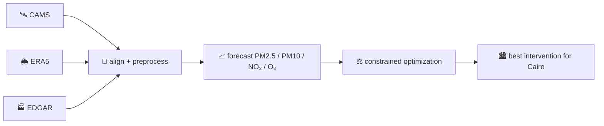
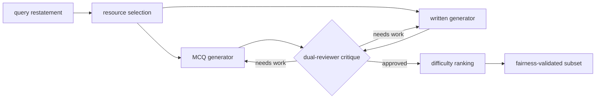

<div align="center">


<a href="https://github.com/seif-3mk-hassan">
  
</a>

<br/>


</div>

---

## `~/whoami`

```python
class Seif:
    role      = "AI & ML Engineer (student, shipping like a pro)"
    studying  = "Computer Science · Data Science & AI @ FCIS, Ain Shams"
    graduates = 2027
    leads     = "AI Track @ ConnectX Club"
    obsessed  = ["agentic systems", "RAG", "local-first AI", "clean data pipelines"]
    currently = "forecasting & optimizing Greater Cairo's air quality"

    def philosophy(self):
        return "build in public. measure everything. teach what you learn."
```

---

## 📊 proof, not promises

<div align="center">

| 📦 repos | 🔥 contributions | 📅 active days | 🧑‍🏫 students mentored |
|:---:|:---:|:---:|:---:|
| **22** | **126** | **37** | **20–50** |


</div>

---

## 🛠️ flagship builds

### 🌍 Air Pollution Source Attribution & Optimization · *graduation project*
forecast-and-optimize system for **Greater Cairo** air quality (PM2.5, PM10, NO₂, O₃). aligns monitoring stations, weather (ERA5) and emissions (EDGAR, CAMS) data, then runs a constrained optimization module to compare intervention scenarios.



### 🧠 Exam / Quiz Generator · *6-agent LangGraph pipeline*
an agentic assessment system: it doesn't just generate questions, it argues with itself until they're fair.



### 🏭 Atlas Industries · *enterprise knowledge assistant*
bilingual agentic RAG system built to answer questions over a company's own documents.

### 🎙️ Local Voice Assistant · *real-time agentic voice AI*
fully local, GPU-accelerated voice assistant. no cloud. no latency tax.

### 🎫 NLP Support-Ticket Classifier
end-to-end pipeline: **TF-IDF + Word2Vec** baselines → **10-layer LSTM** → **RoBERTa** (fine-tuned on SQuAD 2.0).

### ⚙️ Reviews Sentiment API
full ETL (extract → quality check → clean → TextBlob scoring → 3-review rolling average → SQLite) behind a **FastAPI** backend with API-key auth.

<details>
<summary><b>📁 more repos</b></summary>

<br/>

| repo | what it is |
|---|---|
| [OULAD-Student-Perfromane-Prediction](https://github.com/Seif-3mk-hassan/OULAD-Student-Perfromane-Prediction) | predicting student performance, Jupyter |
| [NLP-mini-projects](https://github.com/Seif-3mk-hassan/NLP-mini-projects) | translation, sentiment analysis and more |
| [SwiftDesk-AI-Assistant](https://github.com/Seif-3mk-hassan/SwiftDesk-AI-Assistant) | AI assistant, Python |
| [The-OCR-project](https://github.com/Seif-3mk-hassan/The-OCR-project) | OCR experiments, Jupyter |

</details>

---

## 🧰 tech arsenal

<div align="center">


</div>

```text
LLMs & agents    ████████████████████░  LangGraph · RAG · LoRA fine-tuning
NLP              ███████████████████░░  RoBERTa · LSTM · TF-IDF · Word2Vec
MLOps            ████████████████░░░░░  versioning · CI/CD · monitoring
data pipelines   ██████████████████░░░  Apify · Pydantic · ETL · ERA5/CAMS/EDGAR
backend          █████████████████░░░░  FastAPI · API-key auth · SQLite
```

---

## 🗺️ quest log

```text
2023 ─┬─ 🎓 starts B.Sc. Computer Science @ Ain Shams
      │
2024 ─┼─ 🖥️ New Vision: custom PC builds, sales +20% by matching builds to budgets
      │
2025 ─┼─ 🧑‍🏫 ConnectX Club: AI Track Lead, designs curriculum for 20–50 students
      │     └─ 🏅 certificate of ConnectX Heads (AI Committee)
      │
2026 ─┼─ 🤖 National Technology: AI trainee (MLOps, CI/CD, LoRA fine-tuning)
      ├─ 🔬 Ecolyro: R&D intern
      │     ├─ benchmarked 11 therapy/coaching platforms, sized a $317M MEA market
      │     ├─ compared 7 packaging formats + 3 card stocks, modeled unit costs
      │     └─ built Apify + Pydantic scraper: 500+ pages → 51+ verified tour guides
      │
2027 ─┴─ 🚀 graduation → next build?
```

---

## 🎮 side quests

`🖥️ hardware nerd` · `🎮 gamer` · `🎓 mentor` · `🗣️ bilingual builder (EN / AR)`

---

<div align="center">

### let's build something useful

<a href="mailto:seif253hassan@gmail.com"></a>
<a href="https://linkedin.com/in/seif--hassan"></a>


</div>
